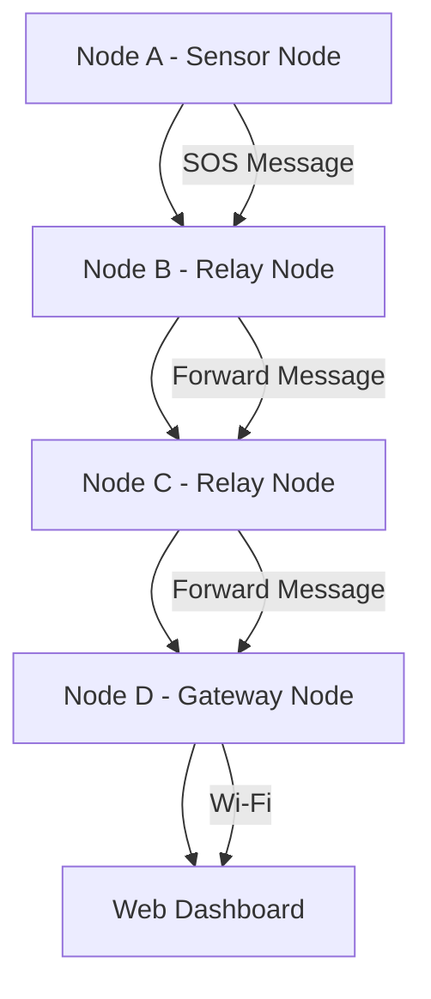
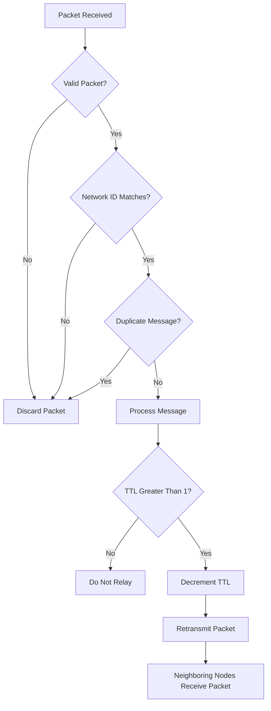
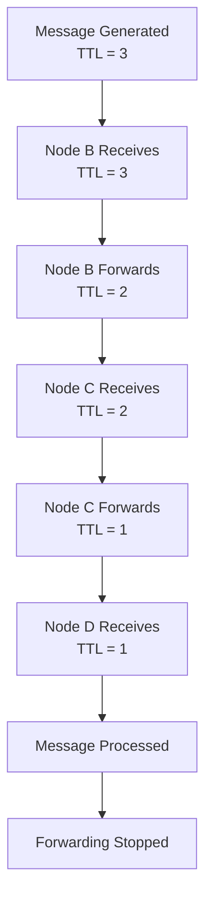
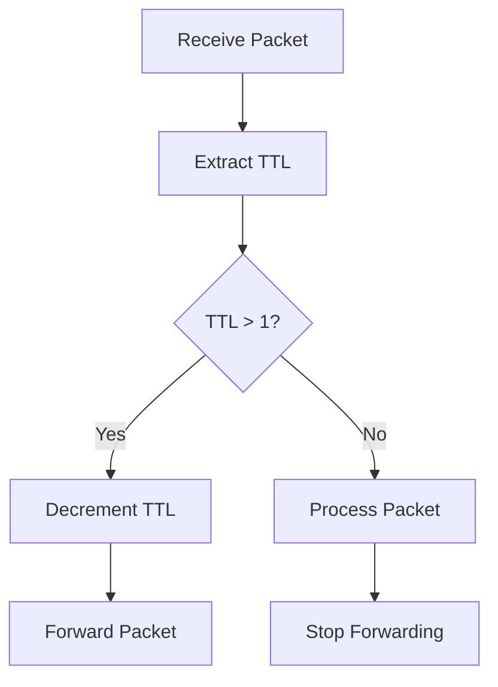
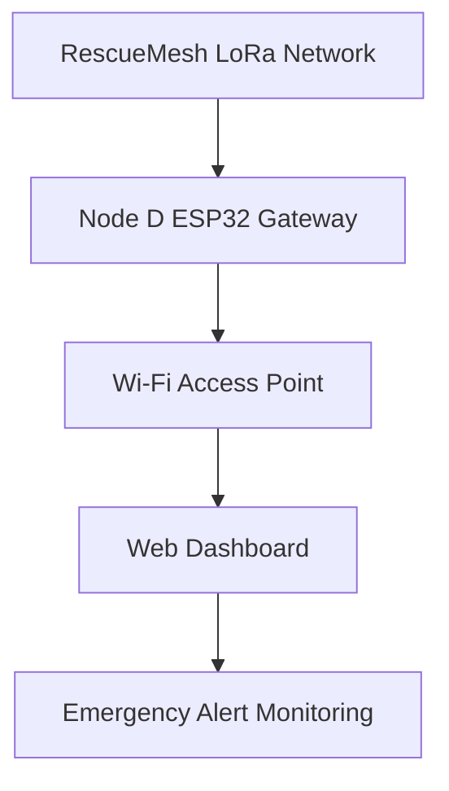
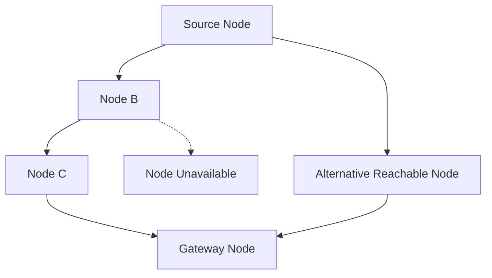

# RescueMesh – Communication Flow

## Overview

RescueMesh enables decentralized communication between ESP32-based
nodes using LoRa wireless technology.

The network allows nodes to transmit emergency messages, receive
messages from neighboring nodes, and relay messages to extend
communication coverage.

## Network Architecture


## 3. Emergency Message Flow
1. Emergency Trigger
An emergency can be triggered through a manual SOS button
or a configured sensor-based event.

Node A detects the event and generates an emergency message.
2. Message Transmission
The originating node transmits the emergency packet through
the LoRa communication interface.
3. Message Reception
Nearby nodes listen for incoming LoRa packets.

When a valid packet is received, the node processes the
message and checks its network identifier and message ID.
4. Duplicate Filtering
Nodes maintain a record of previously processed message IDs.

Duplicate packets are ignored to reduce unnecessary
transmissions and network congestion.
5. Message Relaying
If the received message is eligible for forwarding and its
TTL value permits further transmission, the node forwards
the packet to extend communication coverage.
6. Gateway Processing
Node D acts as the gateway between the LoRa communication
network and the Wi-Fi dashboard interface.
7. Dashboard Alert
The gateway provides received emergency information to
the dashboard for monitoring and visualization.
Packet Structure
RescueMesh uses the following packet format:

NETWORK_ID|MESSAGE_ID|ORIGIN|TTL|PAYLOAD

Example:

RM_SK_7264|A-33|A|3|SOS:Rescue needed
Field	Description
NETWORK_ID	Identifies the RescueMesh network
MESSAGE_ID	Unique identifier for the message
ORIGIN	Node that generated the message
TTL	Maximum number of relay hops permitted
PAYLOAD	Emergency information or message content

## 4. Message Relay Logic

RescueMesh implements a message-relaying mechanism that enables
nodes to forward received packets to neighboring nodes.

The relay process uses network validation, duplicate message
filtering, and Time-To-Live (TTL) management to control
message forwarding.

### Relay Process

1. A node receives an incoming LoRa packet.
2. The packet is checked for validity.
3. The network identifier is verified.
4. The message ID is checked against previously processed messages.
5. Duplicate messages are discarded.
6. Valid, previously unseen messages are processed.
7. The TTL value is checked to determine whether forwarding is permitted.
8. If the TTL is greater than 1, it is decremented.
9. The updated message is retransmitted.
10. If the TTL is 1 or less, the message is not forwarded further.

### Message Relay Flowchart


## 5. Communication Protocol
RescueMesh uses a structured packet format for
identifying and processing messages.
Packet Format
```
NETWORK_ID|MESSAGE_ID|ORIGIN|TTL|PAYLOAD
```

Packet Field Description
|Field|	Description|
|---|---|
|NETWORK_ID|	Identifies the RescueMesh network|
|MESSAGE_ID	|Unique identifier for the transmitted message|
|ORIGIN	|Node that originally generated the message|
|TTL|	Maximum number of relay hops permitted|
|PAYLOAD	|Message content or emergency information|

Example Packet
```
RM_SK_7264|A-33|A|3|SOS:Rescue needed
```

Example Interpretation
|Field|	Value|
|Network ID|	RM_SK_7264|
|Message ID|	A-33|
|Origin|	Node A|
|TTL|	3|
|Payload|	SOS:Rescue needed|


## 6. Time-To-Live (TTL)

Time-To-Live (TTL) is a mechanism used in RescueMesh to limit the number of times a message can be forwarded between nodes.

The TTL value is included in every communication packet and is decremented whenever a node relays the message.

This mechanism prevents messages from circulating indefinitely within the network.

### TTL Mechanism

1. The originating node assigns an initial TTL value.
2. The message is transmitted to neighboring nodes.
3. A receiving node validates and processes the message.
4. If the TTL value is greater than 1, the node decrements the TTL and forwards the message.
5. If the TTL value is 1 or less, the node does not forward the message further.

### TTL Flow Diagram



### Example

Initial packet generated by Node A:

```text
RM_SK_7264|A-33|A|3|SOS:Rescue needed
```

After forwarding through Node B:

```text
RM_SK_7264|A-33|A|2|SOS:Rescue needed
```

After forwarding through Node C:

```text
RM_SK_7264|A-33|A|1|SOS:Rescue needed
```

When the packet reaches a node with TTL equal to 1, the message is processed but not forwarded further.

### TTL Processing Logic



### Advantages of TTL

- Prevents indefinite message circulation.
- Limits unnecessary retransmissions.
- Reduces network congestion.
- Controls message propagation across nodes.
- Helps manage communication traffic in multi-hop networks.

### Implementation

TTL-based forwarding is implemented in the ESP32 firmware of RescueMesh nodes.

The forwarding mechanism checks the TTL value before retransmitting a received packet.

Messages that have reached the forwarding limit are processed without being relayed further.

The TTL mechanism works together with duplicate message filtering to reduce repeated packet transmissions within the network.

### Limitations

TTL limits the number of forwarding hops but does not guarantee message delivery.

Successful communication depends on node availability, wireless signal quality, network topology, and the implemented message-relaying mechanism.

## 7. LoRa Communication Configuration

RescueMesh uses LoRa wireless communication through
SX1278 modules operating in the 433 MHz frequency band.

All nodes are configured with compatible communication
parameters to enable packet transmission and reception
across the network.

### Communication Parameters

| Parameter | Configuration |
|-----------|---------------|
| Frequency | 433 MHz |
| Spreading Factor | SF7 |
| Bandwidth | 125 kHz |
| Coding Rate | 4/5 |
| Sync Word | 0x12 |
| CRC | Enabled |
| Network Identifier | RM_SK_7264 |

### LoRa Communication

LoRa provides long-range wireless communication
with relatively low power consumption.

The technology enables RescueMesh nodes to exchange
messages without relying on cellular networks
or internet connectivity.

The communication range depends on several factors:

- Antenna configuration
- Transmitter power
- Environmental conditions
- Obstacles and interference
- Node placement
- Receiver sensitivity

---

## 8. Gateway Architecture

Node D serves as the gateway between the LoRa
communication network and the monitoring dashboard.

It receives wireless messages from the network
and provides a Wi-Fi interface for dashboard access.

### Gateway Architecture Diagram



### Gateway Responsibilities

- Receive LoRa messages from the network.
- Process incoming communication packets.
- Provide Wi-Fi connectivity for dashboard access.
- Forward relevant emergency information to the dashboard.
- Enable monitoring of network communication.
- Display received emergency alerts.

### Gateway Communication

The gateway uses two communication interfaces:

| Interface | Purpose |
|-----------|---------|
| LoRa | Communication with other RescueMesh nodes |
| Wi-Fi | Communication between the gateway and dashboard |

LoRa handles inter-node wireless communication,
while Wi-Fi provides connectivity between Node D
and the monitoring dashboard.

### Dashboard Access

The dashboard can be accessed by connecting
to the Wi-Fi network provided by Node D.

The gateway interface is configured to provide
dashboard access through its local network.

The IP address and Wi-Fi credentials should be
verified from the Node D firmware.

---

## 9. Network Resilience

RescueMesh is designed to reduce dependence
on a single communication path.

The message-relaying mechanism allows nodes
to forward received messages to neighboring nodes,
potentially extending communication coverage.

### Resilient Communication Concept



### Resilience Mechanisms

#### Message Relaying

Nodes can forward received messages to neighboring
nodes, extending communication beyond the direct
transmission range of the originating node.

#### Duplicate Message Filtering

Message identifiers are used to detect previously
processed packets.

Duplicate packets are discarded to reduce
unnecessary retransmissions.

#### TTL-Based Forwarding

The TTL value limits message propagation
and prevents indefinite packet circulation.

#### Decentralized Communication

The network uses LoRa communication between nodes
without requiring a centralized internet connection
for inter-node message transmission.

### Network Resilience Limitations

The ability of the network to maintain communication
during node failures depends on:

- Available communication paths
- Node placement
- Wireless signal strength
- Network topology
- Implemented routing and forwarding logic

Automatic route discovery and guaranteed alternate-path
recovery are not assumed unless implemented and
experimentally verified.

---

## 10. Communication Limitations

The current RescueMesh prototype has several limitations.

### Wireless Communication

- Communication range depends on environmental conditions.
- Signal quality can be affected by obstacles and interference.
- Reliable communication over large distances requires
  appropriate antenna configuration and placement.

### Network Reliability

- Message delivery is not guaranteed.
- Network performance depends on node availability.
- The prototype has not been validated under large-scale
  network deployment conditions.
- Alternate-path recovery depends on implemented
  routing behavior and network topology.

### Hardware Limitations

- The prototype uses development boards and
  experimental hardware connections.
- Power consumption requires further optimization.
- Battery-powered operation requires additional testing.
- Hardware enclosure and environmental protection
  are future improvements.

### Security Limitations

- The current prototype does not implement
  comprehensive communication encryption.
- Network identification alone does not provide
  cryptographic authentication.
- Secure message transmission requires
  additional implementation.

### Emergency Deployment

RescueMesh is an experimental prototype developed
for educational and demonstration purposes.

It is not a certified emergency communication system
and should not be relied upon for real-life emergency
situations.

---

## 11. Conclusion

RescueMesh demonstrates a decentralized wireless
communication prototype using ESP32 microcontrollers
and SX1278 LoRa modules.

The system supports wireless message transmission,
reception, message relaying, duplicate filtering,
TTL-based forwarding, and emergency alert handling.

The integration of a gateway node with a monitoring
dashboard provides an interface for monitoring
communication and emergency information.

The project explores the potential of decentralized
wireless communication systems in scenarios where
conventional communication infrastructure
may be unavailable.

RescueMesh provides a foundation for further
development in resilient IoT communication,
emergency networking, multi-node wireless systems,
and embedded firmware engineering.
