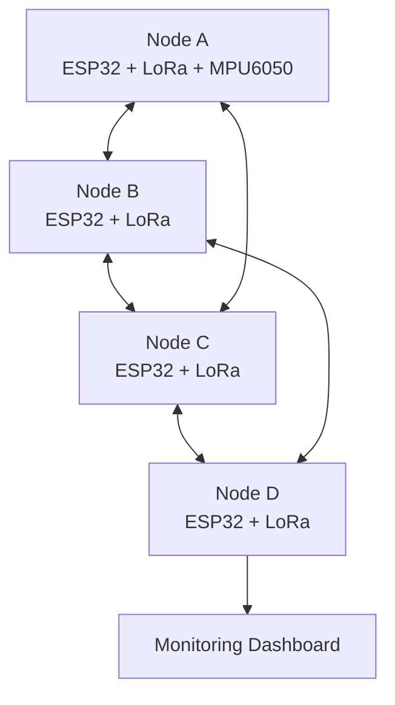

# RescueMesh System Architecture

## 1. Overview

RescueMesh is a decentralized wireless communication network built using ESP32 microcontrollers and LoRa SX1278 communication modules.

The system is designed to maintain communication between nodes even when individual nodes become unavailable or direct communication is not possible.

Unlike conventional communication systems that depend on a central gateway, RescueMesh allows individual nodes to transmit, receive, and forward messages across the network.

## 2. Network Architecture

The network consists of four ESP32-based nodes:

- Node A
- Node B
- Node C
- Node D

Each node operates as an independent communication unit with LoRa transmission and reception capabilities.



The diagram illustrates the concept of multi-node communication. Actual communication links depend on node placement, signal strength, and radio range.

## 3. Node Functionality

Each RescueMesh node is capable of performing the following operations:

### Transmission

Nodes generate and transmit messages containing network information, emergency alerts, or sensor-related data.

### Reception

Nodes continuously monitor the LoRa communication channel for incoming packets.

### Message Forwarding

Received messages can be retransmitted to other nodes, extending communication coverage beyond the range of a single transmitter.

### Duplicate Filtering

Nodes maintain a record of previously received message identifiers to prevent unnecessary retransmissions.

### TTL Management

Each packet contains a Time-To-Live (TTL) value.

The TTL value is decremented during forwarding. Messages are discarded when the forwarding limit is reached, preventing packets from circulating indefinitely.

## 4. Communication Flow

The communication process follows these steps:

1. A node generates a message or emergency alert.
2. The message is formatted into a structured packet.
3. The packet is transmitted through the LoRa module.
4. Nearby nodes receive the packet.
5. The receiving node verifies the network ID.
6. The node checks whether the message has already been processed.
7. The message is processed locally.
8. If forwarding is permitted, the TTL value is decremented.
9. The message is retransmitted to extend network coverage.

## 5. Packet Structure

RescueMesh uses the following packet format:

```text
NETWORK_ID|MESSAGE_ID|ORIGIN|TTL|PAYLOAD
```

### Example

```text
RM_SK_7264|A-33|A|3|SOS:Rescue needed
```

| Field | Description |
|---|---|
| NETWORK_ID | Identifies the RescueMesh network |
| MESSAGE_ID | Identifies an individual message |
| ORIGIN | Identifies the original transmitting node |
| TTL | Controls the maximum forwarding limit |
| PAYLOAD | Contains the message or alert information |

## 6. Emergency Alert System

Node A integrates an MPU6050 accelerometer and a manual SOS button.

The node supports:

- Manual emergency alert activation
- Vibration detection
- Threshold-based impact detection
- Wireless transmission of alerts
- Remote emergency message processing
- LED-based status indication

### Alert Indication

| LED | Status |
|---|---|
| Green | Normal operating condition |
| Yellow | Vibration detected |
| Red | High-impact detected |
| Blinking Red | SOS alert |

The sensor-based alerts are experimental prototype features and are not intended to replace certified safety equipment.

## 7. Dashboard Integration

Node D is connected to the monitoring dashboard in the current implementation.

The dashboard provides a visual interface for monitoring incoming messages and emergency alerts received through the network.

The communication network itself remains decentralized. Node D serves as the dashboard interface rather than acting as a mandatory central communication gateway.

## 8. Communication Configuration

| Parameter | Configuration |
|---|---|
| Wireless Technology | LoRa |
| Communication Module | SX1278 / RA-02 |
| Operating Frequency | 433 MHz |
| Spreading Factor | 7 |
| Bandwidth | 125 kHz |
| Coding Rate | 4/5 |
| Sync Word | 0x12 |
| Packet CRC | Enabled |

## 9. Design Principles

RescueMesh is developed around the following principles:

- Decentralized communication
- Infrastructure-independent operation
- Multi-hop message forwarding
- Reduced dependency on individual nodes
- Duplicate message suppression
- Controlled packet forwarding using TTL
- Emergency-focused communication
- Expandable network architecture

## 10. Future Development

Planned improvements include:

- Dynamic routing
- Improved node failure recovery
- Network health monitoring
- GPS-based location reporting
- Power optimization
- Additional environmental sensors
- Improved dashboard visualization

---

**RescueMesh – Node failure must not become communication failure.**
